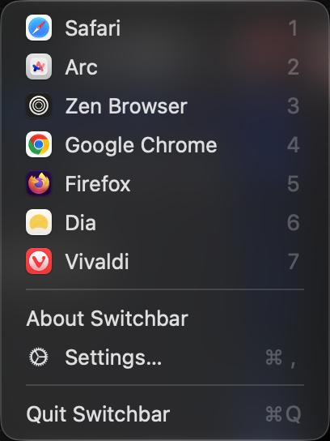

# Switchbar

A native macOS menu bar utility for quickly switching your default browser.

**Website:** https://yukaii.github.io/Switchbar/



Switchbar is a lightweight clone inspired by [Default Browser](https://sindresorhus.com/default-browser) by Sindre Sorhus. It intentionally implements only a small subset of Default Browser's functionality: fast menu bar switching, browser visibility settings, and local preferences.

For the full-featured app, including the broader automation and scripting workflow, use [Default Browser](https://sindresorhus.com/default-browser) instead.

## Features

- Menu bar browser switching with a global keyboard shortcut (Option+Space by default)
- Automatic detection of every installed browser, including Orion web app profiles and other less common browsers
- Detects default-browser changes made in System Settings or by a browser itself
- Drag-and-drop ordering. Drop any app onto the list to add it
- Browser visibility settings and number-key shortcuts (1–9)
- Menu bar icon modes, or a hidden icon with hotkey-only access
- Signed and notarized universal app

## Install

### Download

Download `Switchbar-vX.Y.Z.zip` from the [latest release](https://github.com/Yukaii/Switchbar/releases/latest), unzip it, and move `Switchbar.app` to `/Applications`. Turn on *Launch at login* in Settings.

### Homebrew

```sh
brew tap Yukaii/tap
brew install switchbar
```

To auto-start on login:

```sh
brew services start switchbar
```

To stop auto-starting:

```sh
brew services stop switchbar
```

To install the latest unreleased version from `main`:

```sh
brew install switchbar --HEAD
```

### Build from source

```sh
swift build -c release
.build/release/Switchbar &
```

Or build the app bundle (universal, ad-hoc signed):

```sh
scripts/build-app.sh
open dist/Switchbar.app
```

See [docs/releasing.md](docs/releasing.md) for signing, notarization and the release workflow.

## Usage

Switchbar appears in the macOS menu bar. Click it to see your browsers, or press **Option+Space** to open the menu from anywhere.

Select a browser by clicking or pressing its number key (1-9).

Open **Settings…** from the menu to choose which browsers appear and in what order, change the shortcut, or see the version under **About**. If the menu bar icon is hidden, open Switchbar.app again to get to Settings.

## Reference

This project is inspired by [Default Browser](https://sindresorhus.com/default-browser) by Sindre Sorhus, but it is not a full replacement. If you need the complete feature set, use [Default Browser](https://sindresorhus.com/default-browser).

See Default Browser's [scripting section](https://sindresorhus.com/default-browser#scripting) for its automation support with Shortcuts, Focus filters, and more.

## License

MIT
